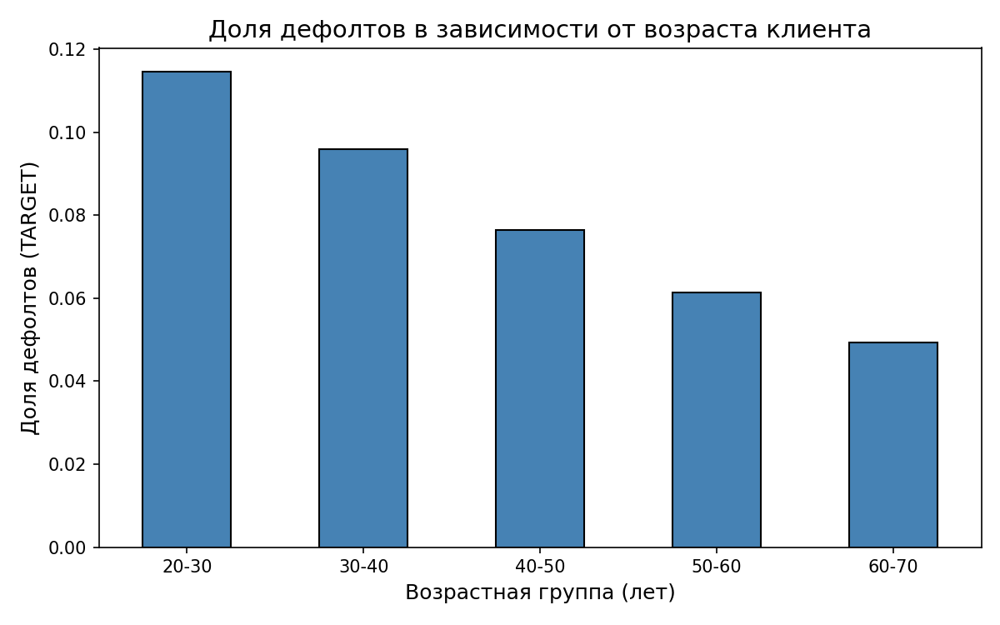
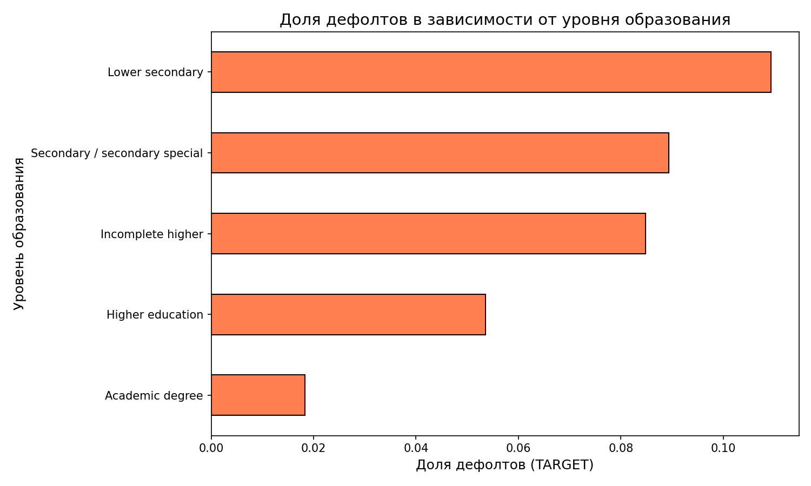
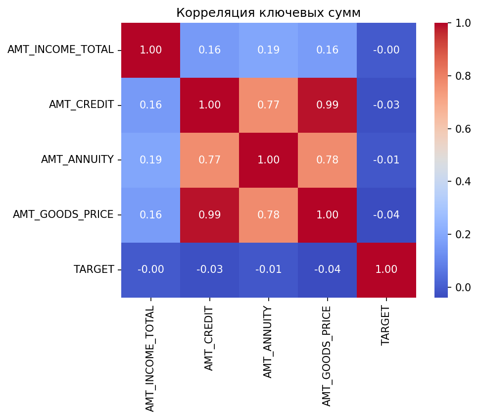
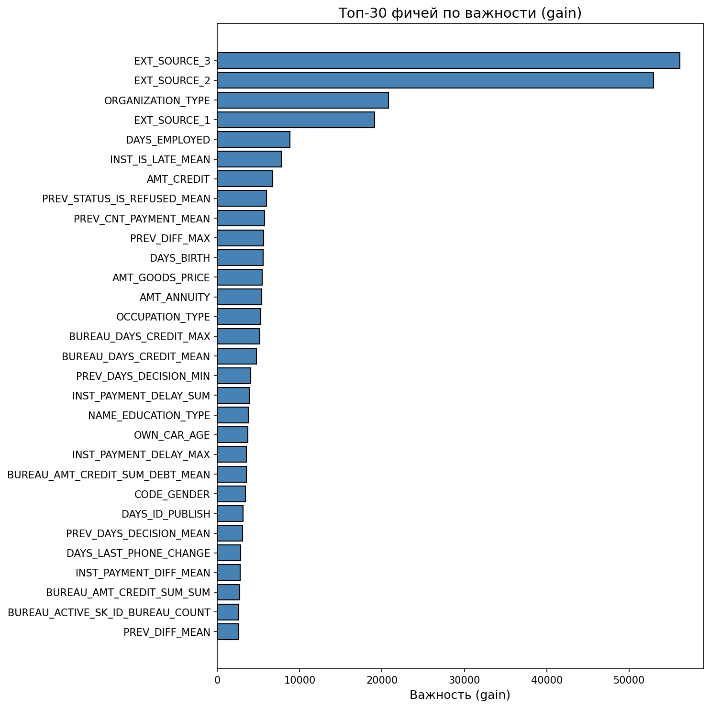
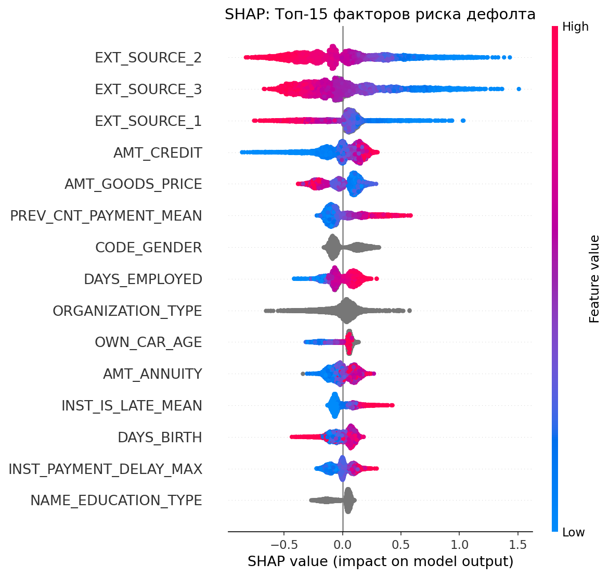
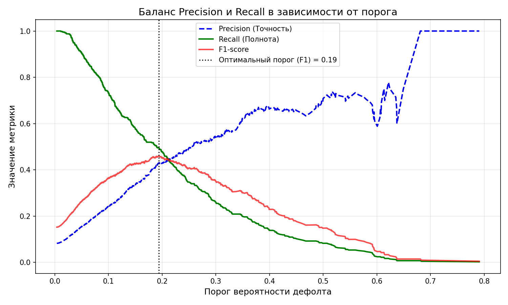

# 🏦 Credit Risk Scoring: Home Credit Default Risk

## 📌 1. Business Context & Problem Statement
In consumer lending, approving a loan is a constant trade-off between revenue (interest income) and risk (credit default). The bank loses the principal if a client defaults. 
The goal of this project is to build a machine learning model that predicts the probability of a client defaulting on a loan. This model acts as a decision-support tool, allowing the bank to automatically approve low-risk clients, automatically reject high-risk clients, and send borderline cases for manual underwriting.

## 📊 2. Data Overview
The dataset is sourced from the [Kaggle Home Credit Default Risk](https://www.kaggle.com/competitions/home-credit-default-risk/data) competition.
*   **Target Variable:** `TARGET` (1 = Client had payment difficulties, 0 = All other cases).
*   **Class Imbalance:** Only **8.07%** of the training set are defaulters. This is a critical factor that dictates the choice of metrics and validation strategy.
*   **Data Sources Used:** 
    *   `application_train.csv` (Main application data, 122 features).
    *   `bureau.csv` & `bureau_balance.csv` (Client's credit history from other banks).
    *   `previous_application.csv` (Client's previous loan applications at Home Credit).
    *   `installments_payments.csv` (History of actual payments on previous loans).
*   *Note: Tables like `credit_card_balance` and `POS_CASH_balance` were intentionally skipped to optimize the time-to-result ratio for this project.*

## 🔍 3. Exploratory Data Analysis & Preprocessing
Key findings and decisions made during EDA:
1.  **Anomalies:** The feature `DAYS_EMPLOYED` contained a technical placeholder `365243` (approx. 1000 years) for unemployed clients, representing **18%** of the dataset. This was replaced with `NaN`.
2.  **Missing Values:** Missing data is highly structured (e.g., housing data is missing for ~70% of clients simultaneously). We avoided median/mode imputation to prevent bias and relied on LightGBM's native ability to handle `NaN` values.
3.  **Non-informative Features:** Identified and removed constants, near-constants (e.g., `FLAG_DOCUMENT_*` where 99% of values were the same), and identifiers (`SK_ID_CURR`).
4.  **Correlations:** Absolute financial sums (e.g., `AMT_CREDIT`) showed near-zero correlation with the target. This validated the need to create *relative* features (e.g., debt-to-income ratios).

Our EDA confirmed key business patterns. For instance, younger clients (under 30) have a significantly higher default rate compared to older demographics. Education level also shows a strong correlation with repayment discipline.

<p align="center">
  
  
</p>

## ⚙️ 4. Feature Engineering
Raw relational tables (one-to-many) were aggregated to one-to-one using `groupby` and `left join`. The main focus was on **behavioral features**:
*   **Bureau:** Counted total and active loans, maximum overdue days (`CREDIT_DAY_OVERDUE`), and total debt.
*   **Previous Applications:** Ratio of refused applications (`PREV_STATUS_IS_REFUSED_MEAN`), and the difference between the requested and approved loan amount (`PREV_DIFF_MAX`).
*   **Installments:** Calculated payment delays (`PAYMENT_DELAY`) and the ratio of late payments (`INST_IS_LATE_MEAN`).
*   **Feature Selection:** After generating ~143 features, a feature importance analysis (gain) showed that 72 features provided 95% of the predictive power. The model was retrained on the **Top-100 features** without loss of quality, making it lighter and faster.

Before training, we analyzed the new features. The heatmap showed high multicollinearity between total debt and active debt, but we intentionally kept both due to LightGBM's robustness. Feature importance analysis allowed us to drop 30% of features without losing predictive power.

<p align="center">
  
  
</p>

## 🤖 5. Modeling Strategy
*   **Algorithm:** **LightGBM**. Chosen for its speed, native categorical feature handling, and robustness to outliers.
*   **Loss Function:** `binary_logloss` (Binary Cross-Entropy) without class weights. We avoided `scale_pos_weight` to keep the probabilities calibrated. Imbalance was addressed later during threshold tuning.
*   **Validation:** `StratifiedKFold` (5 folds) to ensure each fold maintains the 8% default rate.
*   **Hyperparameter Tuning:** **Optuna** (20 trials) was used to prevent overfitting and optimize hyperparameters like `learning_rate`, `num_leaves`, and `reg_alpha/reg_lambda`.

## 📈 6. Results
| Stage | Key Features Added | CV ROC-AUC |
| :--- | :--- | :--- |
| Baseline | Application data only | 0.75851 |
| v1 | + Bureau & Previous App | 0.76965 |
| v2 | + Installments & BB | 0.77534 |
| Final | + Optuna Tuning (Top-100 features) | **0.77938** |

*Feature Importance contribution: Application (70.6%), Previous (12.7%), Bureau (9.5%), Installments (7.2%).*

## 🧠 7. Business Interpretation
### A. SHAP Analysis (Model Explainability)
The SHAP summary plot confirms that the model behaves logically:
*   **EXT_SOURCE_1/2/3:** High external ratings significantly push the risk score down.
*   **INST_IS_LATE_MEAN:** Our engineered feature from payment history is in the top-6 most important features. A high ratio of late payments strongly increases the predicted default risk.
*   **DAYS_BIRTH:** Younger clients show a higher risk profile.

<p align="center">
  
</p>

### B. Threshold Optimization (Operational Impact)
A standard threshold of 0.5 is useless for imbalanced credit scoring. By analyzing the Precision-Recall curve, we determined the optimal threshold to be **0.19**.
*   **Why 0.19?** It maximizes the F1-score, balancing false positives and false negatives.
*   **Operational Load:** At this threshold, **9.8% of clients (~30,000)** are flagged as "risky". 
*   **Business Value:** Within this flagged group, the default rate is ~45% (compared to 8% in the general population). This allows the bank to catch half of all potential defaults while sending only every 10th client to manual review.
*   **Recommendation:** Implement a two-tier system:
    1.  **Probability > 0.30:** Automatic Rejection.
    2.  **Probability 0.10 - 0.30:** Manual Review (Grey Zone).
    3.  **Probability < 0.10:** Auto-Approval.

<p align="center">
  
</p>

## ⚠️ 8. Limitations & Future Work
*   **Validation Strategy:** No time-based validation (out-of-time). The model is validated on random splits, not future data.
*   **Skipped Tables:** Integrating `POS_CASH_balance` could yield a slight metric improvement.
*   **Calibration:** While logloss keeps probabilities relatively calibrated, applying `CalibratedClassifierCV` could align the probabilities closer to true default rates.

## 🚀 9. How to Reproduce
```bash
git clone https://github.com/belovam477-cyber/Credit-risk-analysis
pip install -r requirements.txt

# Build datasets
python src/features.py

# Train final model with best parameters
python src/train_final.py

# Generate SHAP and Threshold plots
python src/interpret_final.py

### 🧪 Usage example (inference)

```python
from src.predict import CreditRiskScorer

scorer = CreditRiskScorer()
result = scorer.score(sk_id_curr=100002)
# {
#   'default_probability': 0.0843,
#   'decision': 'APPROVE',
#   'top_risk_factors': [...]
# }